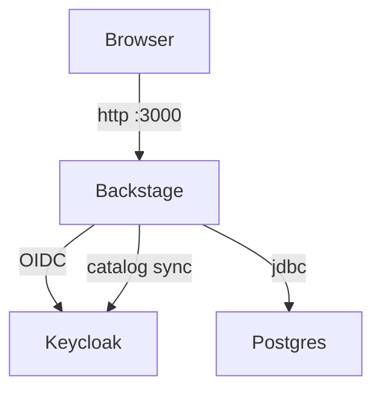

# homelab-backstage

A Backstage deployment for a homelab environment, demonstrating:

- **Keycloak** as identity provider (OIDC sign-in + catalog user/group sync)
- **PostgreSQL** as the catalog database
- Full **Docker Compose** stack for local development
- Production **multi-stage Dockerfile** + **GitHub Actions** CI/CD pipeline

> **Learning project** — code is heavily commented, favouring clarity over
> completeness.  See the "Known gaps" section at the bottom for what's stubbed.

---

## Architecture



| Service | Port | Purpose |
|---------|------|---------|
| Backstage backend | 7007 | API & plugin backends |
| Backstage frontend | 3000 | React UI (dev server) |
| Keycloak | 8080 | OIDC / IdP |
| PostgreSQL | 5432 | Backstage database |

---

## Running locally with Docker Compose

### Prerequisites

- Docker Engine ≥ 24 with Compose plugin
- `make` (optional, but convenient)

### Steps

```bash
# 1. Copy and configure environment variables
cp .env.example .env
# Edit .env and fill in secrets (at minimum BACKEND_SECRET, SESSION_SECRET,
# AUTH_OIDC_CLIENT_SECRET, KEYCLOAK_CATALOG_CLIENT_SECRET)

# 2. Start the full stack
make dev-up
# or: docker compose up -d

# 3. Wait ~60 s for all services to become healthy, then open:
#   Backstage:  http://localhost:3000
#   Keycloak:   http://localhost:8080  (admin / value from .env)
```

### Useful commands

```bash
make dev-logs                  # tail all logs
make dev-restart svc=backstage # restart a single service
make dev-down                  # stop (keep volumes)
make dev-clean                 # stop + remove volumes (full reset)
```

## Configuration Strategy (Robust Multi-Env)

This repo now supports layered Backstage config files so each runtime can load
the right origins, auth environment, and template sources without brittle path
assumptions.

Available overlays:

- `app-config.local.yaml` (yarn local dev, split origin 3000/7007)
- `app-config.local-docker.yaml` (single-origin local Docker on 7007)
- `app-config.k8s-dev.yaml` (Kubernetes dev/staging)
- `app-config.k8s-prod.yaml` (Kubernetes production)

Base config remains in `app-config.yaml`.

### Local yarn dev

```bash
yarn start --config app-config.yaml --config app-config.local.yaml
```

### Local Docker single-origin

```bash
docker run -p 7007:7007 --env-file .env \
  -e APP_CONFIG_ARGS="--config app-config.yaml --config app-config.local-docker.yaml" \
  homelab-backstage:prod.10
```

### Kubernetes (dev/prod)

Set `APP_CONFIG_ARGS` on the deployment:

- Dev: `--config app-config.yaml --config app-config.k8s-dev.yaml`
- Prod: `--config app-config.yaml --config app-config.k8s-prod.yaml`

For K8s overlays, set template source env vars such as:

- `TEMPLATE_REPO_1_URL`
- `TEMPLATE_REPO_2_URL`

Each should point to a raw catalog YAML URL that defines one or more
`Template` entities.

---

## Integrations

### Keycloak

See [docs/keycloak.md](docs/keycloak.md) for full details.

- The compose Keycloak starts empty: create the `backstage` realm, the
  `backstage` OIDC client and the `backstage-catalog-sync` service-account client.
- Sign-in uses the `backstage` OIDC client; catalog sync uses the
  `backstage-catalog-sync` service-account client.
- Sign-in resolver `keycloakIdMatchingUserEntityAnnotation` matches the OIDC
  `sub` (Keycloak user ID) to the `keycloak.org/id` annotation on synced User
  entities, so users must be synced by the catalog provider before they can
  sign in (up to 5 minutes after creation).

Required env vars: `AUTH_OIDC_*`, `KEYCLOAK_*`

### Generic Webhooks

The `webhooks` backend plugin (`packages/backend/src/plugins/webhooks`) and the
`webhook:dispatch` / `webhook:request-vm` scaffolder actions share one client.

| Backstage route | Upstream |
|---|---|
| `ANY /api/webhooks/<app>/<event>` | `${WEBHOOK_BASE_URL}/api/webhooks/<tenant>/<app>/<event>` |
| `GET /api/webhooks/operator/<id>/status` | `${WEBHOOK_BASE_URL}/api/operator/webhooks/<id>/status` |

- Callers need Backstage user or service credentials. External systems should
  use a static token under `backend.auth.externalAccess`.
- Method, query string, body and headers pass through, except `authorization`,
  `cookie`, hop-by-hop headers and anything starting with `x-backstage-`.
- Backstage adds `x-backstage-principal` (user entity ref or `service:<subject>`)
  and, from scaffolder actions, `x-backstage-task-id`.
- `tenant`, `app`, `event` and `id` must match `^[A-Za-z0-9][A-Za-z0-9._-]*$`.
- Tenant is `WEBHOOK_TENANT`, defaulting to `backstage-production`
  (`backstage-development` in the local-docker overlay).
- If `WEBHOOK_SIGNING_SECRET` is set, upstream requests carry
  `x-backstage-timestamp` and `x-backstage-signature: sha256=<hex>`, an
  HMAC-SHA256 over `v1:<timestamp>:<METHOD>:<path?query>:<raw body>`.
- The `/webhook-status?id=<id>` page reads status through the backend route.

---

## Production image pipeline

The root `Dockerfile` is a multi-stage build:

1. **build** stage — full Node 20, installs deps, runs `yarn tsc` and
   `yarn build:backend`.
2. **runtime** stage — slim Node 20 (`bookworm-slim`), non-root user, copies
   only the compiled backend bundle + frontend assets.

The GitHub Actions workflow `.github/workflows/build-image.yml`:

- Runs a **quality gate** (typecheck + tests) before building.
- Builds and pushes to **GitHub Container Registry** (`ghcr.io/<owner>/<repo>`).
- Tags with git SHA and (on version tags) semver.
- Uses **BuildKit layer caching** via `cache-from/cache-to: type=gha`.
- Runs a **Trivy** vulnerability scan on the pushed image (non-blocking).

A separate `.github/workflows/ci.yml` runs lint + typecheck + unit tests on
every pull request.

## Local image publish workflow (VS Code)

For local-first CI/CD, this repo includes an intelligent Docker tag workflow
that mirrors the GitHub Actions tagging strategy and can be run from VS Code.

### Tagging behavior

- If `HEAD` is exactly a release tag `vX.Y.Z`:
  - `X.Y.Z`
  - `X.Y`
  - `latest`
  - `sha-<12-char git sha>`
- Otherwise:
  - next patch inferred from latest semver tag (or `0.1.0` if none)
  - dev tag: `<next>-dev.<commits-since-tag>[-<branch>]`
  - branch channel tag: `edge` (main/master) or `branch-<branch>`
  - `sha-<12-char git sha>`

### Make targets

```bash
make docker-tags    # preview tags for current commit
make docker-build   # build image with all computed tags
make docker-push    # push all computed tags
make publish        # build + push (local CI/CD flow)
```

By default images publish to:

- `image-local.int.shaut.us/homelab-backstage`

Override registry/image when needed:

```bash
make publish REGISTRY=ghcr.io IMAGE_NAME=<owner>/<repo>
```

### VS Code Tasks

Use **Terminal → Run Task** and choose:

- `Docker: Show computed tags`
- `Docker: Build intelligent version`
- `Docker: Push intelligent version`
- `Docker: Publish (build + push)`

---

## Known gaps / next steps

| Area | Status | Notes |
|------|--------|-------|
| Keycloak prod TLS | ❌ Not done | Compose uses `start-dev`; production would need `start` + TLS certs |
| Permission policy | ⚠️ Basic | Allow-all, except template runs can be limited via `permission.templateRunnerGroups` |
| TechDocs | ⚠️ Basic | Local builder, no external storage |
| Test coverage | ⚠️ Partial | Webhook client/router and permission policy are unit tested |
| Kubernetes plugin | ⚠️ Enabled | No cluster connected; configure via `app-config.yaml` |
